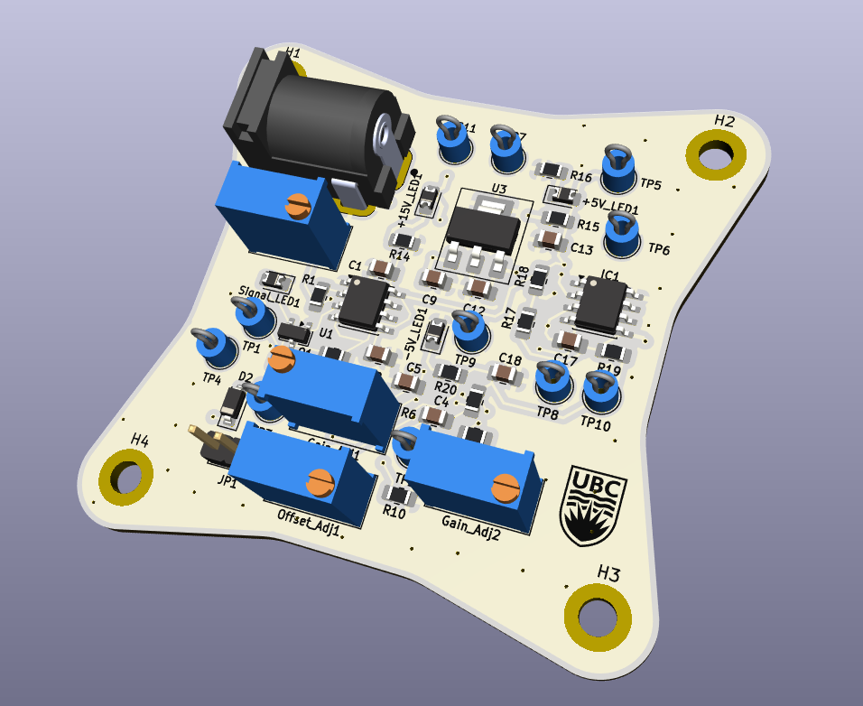
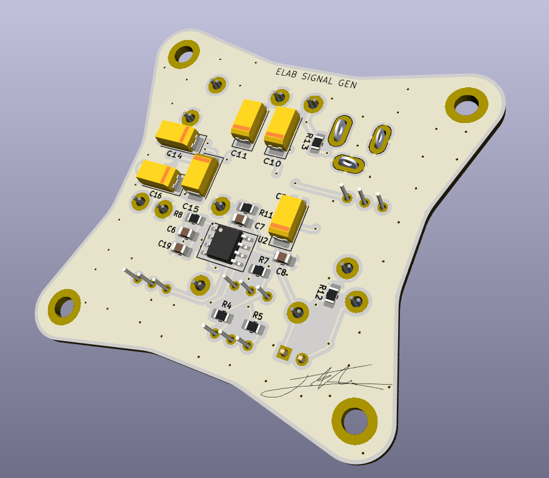
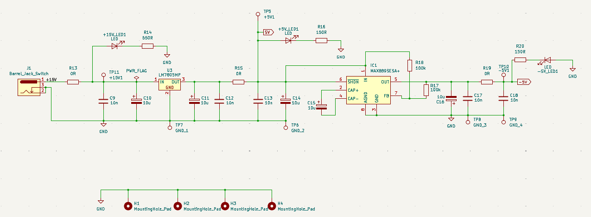
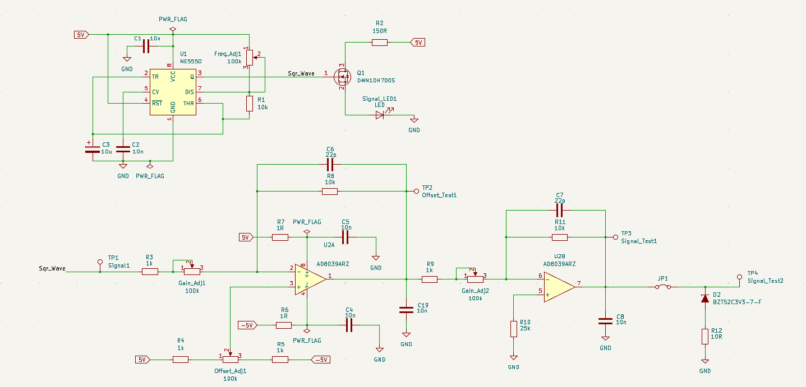
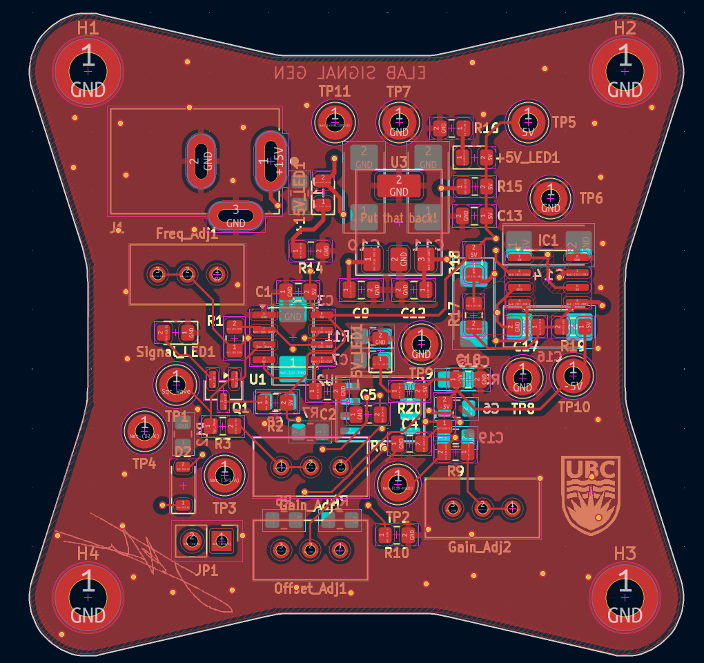
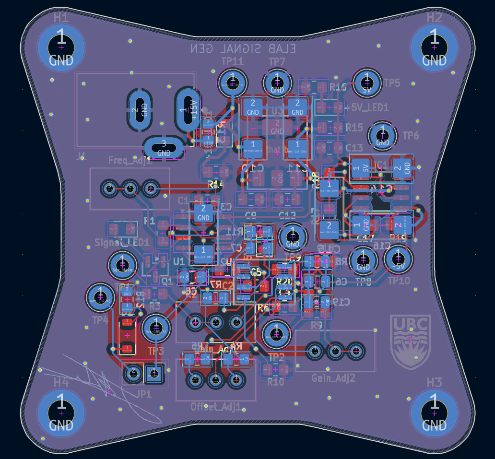

# UBC Physics and Astronomy | Signal Generator
A square wave generator with adjustable frequency, gain, and offset, designed for UBC Physics and Astronomy's ELAB PCB design course.

### **Skills used in this project**
***KiCad · Analog Circuit Design · Hand Soldering · Testing/Validation***

---

  
  

## Overview
The designed circuit is a simple square wave generator. The goal of the course was to take a PCB through the full production cycle, so the project covers:

- Schematic capture
- Custom component and footprint libraries
- Component placement, trace routing, and polygon pours
- Hand soldering of the delivered boards and components
- Testing with an oscilloscope to verify the signal and each adjustment

| Spec | Value |
|---|---|
| Output | Square wave, up to 10 V peak-to-peak |
| Supply | 15 V DC via barrel jack |
| Internal rails | ±5 V |
| Adjustable | Frequency, Gain, DC Offset |
| Output protection | Optional 3.3 V zener peak limiter (jumper-selectable) |

## Design

### Power Supply
To output up to 10 V peak-to-peak, the board needs ±5 V rails. A 15 V wall adapter feeds a barrel jack, and an **LM7805** regulates it down to +5 V. That rail then drives a **MAX889** charge pump, which generates the complementary −5 V rail. Input and output capacitors reduce noise and output ripple.

  

### Signal Chain
An **NE555** generates the square wave, with a potentiometer to adjust the frequency. The signal then passes through two **AD8039** op-amp stages, which set the gain and offset respectively. Bypass capacitors on the op-amp supply pins reduce noise and stabilize the rails.

At the output, a 3.3 V zener diode can be engaged with a jumper to limit the peak voltage.

  

### PCB Layout
This was my first PCB, and the layout reflects that: there is room to improve both the trace routing and component placement. The main constraints were:

- **Board size:** limited by the course. I chose a custom outline, a common shape for small boards that need to be mounted.
- **Bulky capacitors:** the large 1206 capacitors are on the back side, since they left very little room for other parts on the front.
- **Noise:** the 2-layer board has a ground pour on each layer, joined by stitching vias.

  
  

# Assembly
<!-- TODO: hand-soldering process, order of assembly, tools used, any problems (e.g. fine-pitch parts, rework) -->

# Testing
<!-- TODO: oscilloscope captures, measured frequency range, output swing, gain/offset behavior, zener limiting, power rail voltages -->

# Lessons Learned
<!-- TODO: what you would change in a second revision (routing, placement, decoupling, test points, etc.) -->
